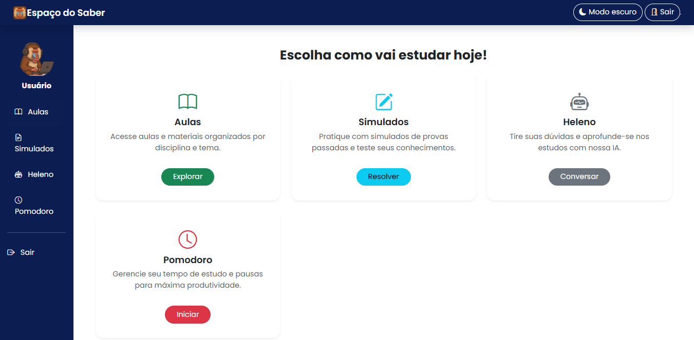
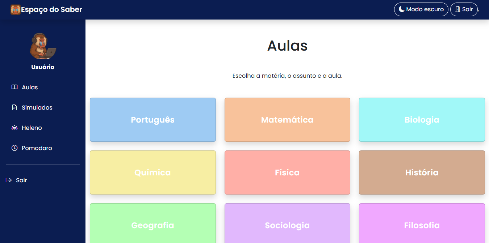
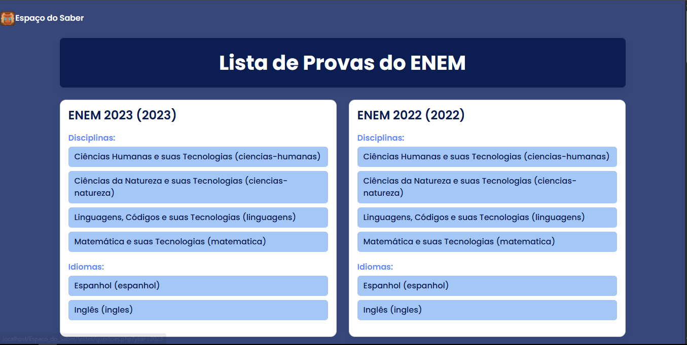
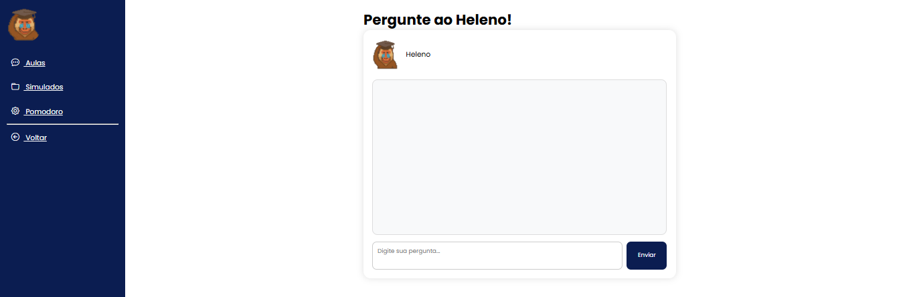

# 📚 Espaço do Saber

**Espaço do Saber** é uma plataforma educacional desenvolvida com o objetivo de proporcionar uma experiência de aprendizagem mais dinâmica, organizada e interativa.

A plataforma reúne ferramentas de estudo em um único ambiente, permitindo que os usuários acessem aulas, realizem simulados, organizem seu tempo de estudo e tirem dúvidas com o auxílio de uma inteligência artificial.

## 🚀 Funcionalidades

- **🏠 Página inicial:** ambiente principal com acesso às funcionalidades da plataforma.
- **📖 Aulas:** espaço dedicado à disponibilização e organização dos conteúdos educacionais.
- **📝 Simulados:** exercícios para testar conhecimentos e acompanhar o aprendizado.
- **⏱️ Pomodoro:** ferramenta de gerenciamento de tempo baseada na técnica Pomodoro, auxiliando na concentração e produtividade.
- **🤖 Heleno — Assistente de IA:** assistente virtual integrado à plataforma, desenvolvido para responder dúvidas e auxiliar os estudantes durante seus estudos.

## 🖥️ Demonstração da plataforma

Confira algumas telas do Espaço do Saber:

### Página inicial

### Área de aulas

### Simulados

### Temporizador Pomodoro

### Heleno — Assistente de IA

# 🛠️ Tecnologias utilizadas

O Espaço do Saber foi desenvolvido utilizando as seguintes tecnologias:

- **PHP:** desenvolvimento da lógica de funcionamento e processamento do sistema no back-end.
- **MySQL:** gerenciamento e armazenamento dos dados da plataforma.
- **CSS3:** estilização e construção da interface visual.
- **JavaScript:** implementação de interatividade e funcionalidades dinâmicas no front-end.

## 🎯 Objetivo do projeto

O Espaço do Saber surgiu com a proposta de centralizar diferentes recursos educacionais em uma única plataforma, tornando a rotina de estudos mais acessível, produtiva e interativa.

Além de oferecer ferramentas tradicionais de aprendizagem, o projeto explora a integração de inteligência artificial como recurso de apoio aos estudantes.

## 📌 Status do projeto

🚧 Concluido

## 👨‍💻 Desenvolvedores

Karol Siqueira, Rebeka Lima, Gabriel Cleyton e Gabriel Sheldes

⭐ Se você gostou do projeto, considere deixar uma estrela no repositório!
